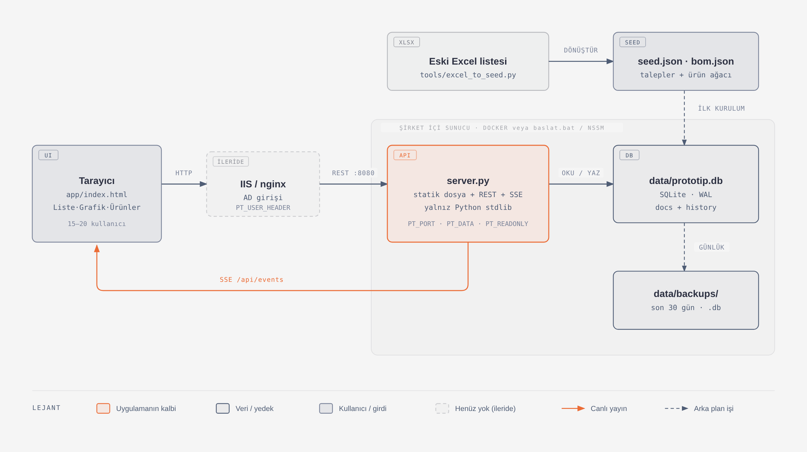

# Sanel Ar-Ge Prototip Takip 

Ar-Ge biriminin prototip talep listesini (eski "Ar-Ge Prototip List.xlsx") tarayıcıdan, birden fazla kişinin aynı anda kullanabileceği bir web uygulaması. Kullanıcılar talepleri, alt parçaları, durumları ve terminleri tarayıcıdan günceller; değişiklikler açık olan diğer ekranlara anında yansır.

## Özet

| | |
|---|---|
| Çalışma ortamı | Python 3.9 veya üstü (yalnızca standart kütüphane, `pip install` gerekmez) ya da Docker |
| Veritabanı | Tek dosya SQLite: `data/prototip.db` |
| Port | Docker/Portainer dış portu 1273; uygulama iç portu 8080 |
| Dış bağlantı | Yok. Sayfa internetten hiçbir şey yüklemez |
| Giriş | Şirket kullanıcı adı ve şifresiyle (Active Directory / LDAP) + bir yerel yönetici hesabı |
| Yetki | Kullanıcı bazında rol: Görüntüleme, Proje Mühendisi (talep açar, yönetici onaylar), Düzenleme, Yönetici (onay + yetki verir), Engelli |
| Yedek | Günlük otomatik (`data/backups/`, son 30 gün) + **Yönetim → Yedekler**'den tek tıkla `.db` indirme |
| Kayıt geçmişi | Her değişiklik kim/ne zaman bilgisiyle `history` tablosuna yazılır |

## Sistem şeması



- **Tarayıcı** sayfayı (`app/index.html`) sunucudan alır; bütün okuma/yazma `REST /api/...` ile yapılır.
- **server.py** değişikliği SQLite'a yazar, `history` tablosuna kim/ne zaman bilgisini ekler ve aynı olayı **SSE** (`/api/events`) ile açık olan tüm sekmelere gönderir; başka kullanıcılar sayfayı yenilemeden görür.
- **İlk kurulumda** veritabanı boşsa `seed/seed.json` yüklenir (Excel'den `tools/excel_to_seed.py` ile üretilir).
- **Yedek:** her gün `data/backups/` altına tutarlı bir `.db` kopyası alınır.
- **Giriş:** kullanıcı adı ve şifre `server.py` → `auth.py` üzerinden Active Directory'ye (LDAP) sorulur; şifre hiçbir yerde saklanmaz. Kullanıcının rolü SQLite'ta tutulur ve her istekte kontrol edilir.

Şemanın kaynağı `docs/mimari.html` (tarayıcıda açılır) ve `docs/mimari.svg`.

## Ekranlar

| Sekme | Kim kullanır | Ne gösterir |
|---|---|---|
| **Teslimatlar** | Herkes (açılış sayfası) | Solda müşteri → faz rayı. Bir faz seçilince her teslim yeri/tarih bir kart olur (ör. DCV: Farplas 13 Kas, Ford 16 Kas, Oto Trim 7 Ara). Altta her teslimat tarih bloğu, kalan gün ve ilerlemeyle; ürün satırına tıklayınca alt parçalar açılır ve düzenlenir. Yalnızca **onaylı** talepler görünür. |
| **Özet** | Herkes | 5 kutu (geciken, önümüzdeki 3 hafta, genel ilerleme, onay bekleyen, termini belirsiz), **aylık teslimat takvimi**, yaklaşan teslimatlar, eksik bilgiler. Müşteriye göre süzülür. Takvimdeki ya da listedeki bir teslimata tıklayınca Teslimatlar'da o teslimat açılır. |
| **Grafik** | Herkes | Termin çizelgesi (her ürünün faz terminleri, bugün çizgisi; bitti / termini geçti / 14 gün içinde / ileride), ürün bazlı ilerleme, sorumlu iş yükü, üreticide bekleyen. Müşteri, ürün, sorumlu ve aramayla süzülür; işarete ya da çubuğa tıklayınca Teslimatlar'da açılır. |
| **Ürünler** | Herkes (düzenleme: Düzenleme/Yönetici) | Ürün listesi ve kodla arama. Ürün detayında **Ford / Iveco / Sanel kodları** üç ayrı kartta (kopyala düğmesiyle), ürünün tüm faz/teslimatları ve ürün ağacı. |
| **Onaylar** | Yönetici karar verir; herkes görür | Proje mühendislerinden gelen talepler ana listeden ayrı, burada bekler: Bekleyen / Reddedilen / Son onaylanan. Yönetici adetleri düzeltip onaylar (toplu onay da var) ya da nedenini yazıp reddeder. |
| **Yönetim** | Düzenleme: Faz planı, Listeler · Yönetici: + Yedekler, Kullanıcılar | **Yedekler:** "Şimdi yedek indir (.db)" ve günlük yedeklerin listesi. **Kullanıcılar ve yetkiler**, **Faz planı** (termin değişince bağlı talepler güncellenir), **Listeler**. |

**Yeni talep** üç türlüdür: *Plandaki teslimat* (faz planından seç), *Yeni faz ya da teslim yeri* (plana yeni satır; aynı faza ikinci bir tarih de böyle eklenir), *Fazsız, sadece tarih* (faza bağlı olmayan tek seferlik teslimat; Teslimatlar'da "Fazsız teslimatlar" altında ve takvimde görünür). Aynı ekrandan **yeni ürün** de eklenebilir (alt parçalar başka bir üründen kopyalanabilir ya da şablondan gelir).

## Klasör yapısı

```
prototip-takip/
├─ server.py            Sunucu (HTTP + API + canlı güncelleme + yedek)
├─ auth.py              Giriş (AD/LDAP), yerel yönetici, roller ve oturumlar
├─ app/index.html       Arayüz (tek dosya)
├─ seed/seed.json       İlk kurulum verisi ("H84X PROTOTİPLER GENEL" Excel'inden üretildi)
├─ tools/genel_to_seed.py   Excel (ürün × faz matrisi) → seed.json dönüştürücü (openpyxl gerekir)
├─ docs/                Sistem şeması (png, svg, html)
├─ data/                Veritabanı ve yedekler (ilk çalıştırmada oluşur)
├─ Dockerfile, docker-compose.yml
└─ baslat.bat           Windows'ta hızlı deneme
```

## Kurulum (IT için, adım adım)

Aşağıdaki adımlar Docker kurulu bir Linux sanal makine içindir (önerilen). Docker olmadan kurulum en altta.

### Portainer ile yayınlama

`docker-compose.yml`, Portainer Stack üzerinden Git deposundan yayınlanacak şekilde hazırlanmıştır:

- Sunucu portu: `1273` (konteyner içinde `8080`)
- Kalıcı veri: `prototip-takip-data` adlı Docker volume
- LDAP ve yönetici bilgileri: Portainer ortam değişkenleri
- Gerçek `.env` dosyası Git tarafından yok sayılır; örnek değerler `.env.example` içindedir.

Portainer'da **Stacks → Add stack → Repository** yoluyla bu depoyu seçin ve Compose yolu olarak
`docker-compose.yml` girin. Ardından **Environment variables** bölümünde en az şu üç değişkeni tanımlayın:

```dotenv
PT_LDAP_URL=ldaps://ldap.example.local:636
PT_LDAP_DOMAIN=example.local
PT_ADMIN_PASSWORD=en-az-10-karakter-guclu-bir-sifre
```

Diğer kullanılabilir değerleri `.env.example` dosyasından ekleyebilirsiniz. Yayınlama tamamlandığında uygulama:

```text
http://<portainer-sunucusu>:1273
```

adresinden açılır. İlk çalıştırmada `PT_ADMIN_PASSWORD`, `PT_ADMIN_USER` (varsayılan `admin`) hesabını
oluşturur. Güvenlik nedeniyle sonraki yeniden başlatmalarda mevcut yönetici şifresini otomatik olarak
değiştirmez. Şifreyi sonradan değiştirmek için Portainer konsolunda şunu çalıştırın:

```bash
python server.py --set-admin-password
```

Stack silinip yeniden oluşturulsa bile `prototip-takip-data` volume'u silinmediği sürece veriler korunur.
Portainer'da stack/volume silerken volume'u ayrıca silmeyin. HTTPS ters vekili kullanılacaksa
`PT_COOKIE_SECURE=1` ayarlayın.

### 0. Gereksinimler

| | |
|---|---|
| Sunucu | Küçük bir sanal makine yeterli (uygulama ~25 MB RAM kullanır, veri 1 MB'tan küçük) |
| Yazılım | Docker + Docker Compose (ya da Docker olmadan Python 3.9+) |
| Ağ (gelen) | 1273/TCP yalnızca iç ağdan; isteğe bağlı iç adres, ör. `prototip.sanel.local` |
| Ağ (giden) | Sunucudan Active Directory'ye: `10.34.10.1:389` (ldaps kullanılacaksa `:636`) |
| İnternet | Yalnızca imaj derlenirken `python:3.12-slim` indirmek için; uygulama çalışırken gerekmez |

### 1. Kodu alın

```bash
git clone https://gitlab.sanel.com.tr/Berkay.Yilmaz/prototype-tracking-system.git
cd prototype-tracking-system
ls data          # yalnızca .keep olmalı; veritabanı ilk açılışta oluşur
```

### 2. Ayarları kontrol edin

Önce `.env.example` dosyasını `.env` olarak kopyalayıp gerçek LDAP ve yönetici değerlerini girin:

```bash
cp .env.example .env
# .env dosyasını düzenleyin
```

`.env` Git tarafından yok sayılır. Dosyanın erişim izinlerini yalnızca servis yöneticisinin okuyabileceği
şekilde sınırlandırın.

### 3. Başlatın

```bash
docker compose up -d --build
docker compose ps                      # STATUS: Up ... (healthy)
docker logs prototip-takip
```

Logda şunlar görülmeli:

```
Yerel yönetici 'admin' oluşturuldu (PT_ADMIN_PASSWORD).
İlk kurulum: seed.json'dan 71 belge yüklendi.
Giriş zorunlu. Şirket hesabı: ldaps://ldap.example.local:636 (alan: example.local) | ilk girişte rol: viewer
Prototip Takip çalışıyor: http://0.0.0.0:8080  (veri: /data)
```

### 4. Active Directory bağlantısını deneyin

```bash
docker compose exec prototip-takip python server.py --ldap-test berkay.yilmaz
# Şifre sorar. Beklenen: "BAŞARILI. Görünen ad: Berkay Yılmaz"
```

Başarısız olursa → aşağıdaki **Sorun giderme** tablosu.

### 5. Yerel yönetici şifresini belirleyin

`PT_ADMIN_PASSWORD` ilk çalıştırmada yönetici hesabını otomatik oluşturur. Değişken kullanılmadığı eski
kurulumlarda veya şifreyi sonradan değiştirmek istediğinizde:

```bash
docker compose exec prototip-takip python server.py --set-admin-password
# Şifreyi iki kez sorar (en az 10 karakter). Şifreyi kurum şifre kasasına kaydedin.
```

### 6. Tarayıcıdan ilk giriş ve yetkiler

1. `http://<sunucu-adresi>:1273` açın, kullanıcı adı `admin` ve `.env`/Portainer'daki şifreyle girin.
2. **Yönetim → Kullanıcılar ve yetkiler** bölümünde *Kullanıcı adı* alanına `berkay.yilmaz` yazın, rol **Yönetici** seçip *Ekle / güncelle*.
3. Bundan sonra yetkileri Ar-Ge (Berkay Yılmaz) dağıtır. Diğer şirket kullanıcıları kendi Windows kullanıcı adı ve şifresiyle girer; ilk girişte "Görüntüleme" rolü alır.

### 7. Yedek ve iç adres

- **Yedek:** sunucu her gün `data/backups/prototip-YYYY-AA-GG.db` dosyasını oluşturur (son 30 gün). Kurum yedeklemesine `data/backups/` klasörünü ekleyin. (Çalışan `data/prototip.db` dosyasını tek başına kopyalamayın; son değişiklikler yanındaki `-wal` dosyasında bekler.)
- **İç adres / güvenlik duvarı:** 1273'ü yalnızca iç ağa açın; isteğe bağlı DNS kaydı (ör. `prototip.sanel.local`).

### Kontrol listesi

- [ ] `docker compose ps` → healthy
- [ ] `--ldap-test` → BAŞARILI
- [ ] `admin` ile giriş yapıldı, `berkay.yilmaz` Yönetici yapıldı
- [ ] Başka bir bilgisayardan şirket hesabıyla giriş yapılabiliyor
- [ ] İki farklı bilgisayarda açıkken birinde yapılan değişiklik diğerinde anında görünüyor
- [ ] `data/backups/` kurum yedeklemesine eklendi

### Sorun giderme

| Belirti | Neden / çözüm |
|---|---|
| `--ldap-test`: "Kimlik sunucusuna ulaşılamadı" | Sunucudan `10.34.10.1:389`'a erişim yok (güvenlik duvarı). Konteyner içinden deneyin: `docker compose exec prototip-takip python -c "import socket;socket.create_connection(('10.34.10.1',389),3);print('ok')"` |
| "Kullanıcı adı veya şifre hatalı" (şifre doğru olduğu halde) | AD `kullanici@sanelelk.local` biçimini kabul etmiyor olabilir. `docker-compose.yml`'a `PT_LDAP_BIND_FORMAT: 'SANELELK\{user}'` ekleyip `docker compose up -d` |
| "Şifreli bağlantı istiyor" | AD'de LDAP signing zorunlu. `PT_LDAP_URL: ldaps://10.34.10.1:636` kullanın |
| "Sertifikası doğrulanamadı" (ldaps) | Kurum CA sertifikasını `data/sirket-ca.pem` olarak koyup `PT_LDAP_CA_FILE: /data/sirket-ca.pem` |
| "Hesabınız kilitlenmiş / şifrenin süresi dolmuş" | AD hesabıyla ilgili; Windows'ta düzeltilmeli |
| "Çok fazla hatalı deneme" | 5 hatalı denemeden sonra 5 dakika bekleme; kendiliğinden açılır |
| Yönetici şifresi unutuldu | 5. adımdaki komutu tekrar çalıştırın (yeni şifre verilir) |
| Sayfa açılıyor ama liste boş / eski veri | `data/` klasöründe repodan gelmiş eski bir veritabanı olabilir. Konteyneri durdurup `data/prototip.db*` dosyalarını silin ve tekrar başlatın (ilk kurulumda veri yoksa) |
| Canlı güncelleme gecikiyor (vekil arkasında) | Vekilde `/api/events` için tamponlamayı kapatın (nginx: `proxy_buffering off;`) |

### Güncelleme (yeni sürüm geldiğinde)

```bash
git pull
docker compose up -d --build      # veri ./data'da kalır, kaybolmaz
```

### Docker olmadan: Windows sunucu

1. Python 3.9+ kurun ("Add to PATH" işaretli).
2. Klasörü örneğin `D:\prototip-takip` altına kopyalayın.
3. Deneme: `baslat.bat` (içindeki `PT_LDAP_URL` ve `PT_LDAP_DOMAIN` satırlarının başındaki `REM`'i kaldırın) → `http://localhost:8080`.
4. Yönetici şifresi: `python server.py --set-admin-password`
5. Kalıcı çalışma için Windows hizmeti (örnek: NSSM):
   ```
   nssm install PrototipTakip "C:\Program Files\Python312\python.exe" "D:\prototip-takip\server.py --port 8080 --data D:\prototip-takip\data"
   nssm set PrototipTakip AppDirectory D:\prototip-takip
   nssm set PrototipTakip AppEnvironmentExtra PT_LDAP_URL=ldap://10.34.10.1:389 PT_LDAP_DOMAIN=sanelelk.local
   nssm start PrototipTakip
   ```
6. Güvenlik duvarında 8080'i yalnızca iç ağa açın.

### Docker olmadan: Linux (systemd)

```ini
# /etc/systemd/system/prototip-takip.service
[Service]
WorkingDirectory=/opt/prototip-takip
Environment=PT_LDAP_URL=ldap://10.34.10.1:389 PT_LDAP_DOMAIN=sanelelk.local
ExecStart=/usr/bin/python3 server.py --port 8080 --data /var/lib/prototip-takip
Restart=always
User=prototip
[Install]
WantedBy=multi-user.target
```

İlk çalıştırmada veritabanı boşsa `seed/seed.json` otomatik yüklenir.

## Giriş ve yetkiler

`PT_LDAP_URL` ayarlıyken uygulama açılışta giriş ekranı gösterir. Kullanıcılar Windows'ta kullandıkları kullanıcı adı ve şifreyle girer (`berkay.yilmaz`, `SANELELK\berkay.yilmaz` ve `berkay.yilmaz@sanelelk.local` yazımlarının hepsi kabul edilir).

**Nasıl çalışır:** Sunucu, girilen ad ve şifreyle Active Directory'ye bağlanmayı dener (LDAP simple bind, `kullanici@sanelelk.local`). AD kabul ederse şifre doğrudur. Şifre uygulamada saklanmaz; yalnızca kullanıcının adı ve rolü `data/prototip.db` içindeki `users` tablosuna yazılır. Oturum, tarayıcıya verilen HttpOnly bir çerezle sürer (varsayılan 7 gün).

| Rol | Ne yapabilir |
|---|---|
| Görüntüleme (`viewer`) | Özet, Teslimatlar, Ürünler ve Onaylar'ı görür, Excel'e aktarır |
| Proje Mühendisi (`engineer`) | Görür; **talep oluşturur** (yeni faz, fazsız teslimat ve yeni ürün önerisi dahil), talep yönetici onayına gider (aşağıda) |
| Düzenleme (`editor`) | Talep, parça, durum, ürün ağacı, faz planı ve listeleri değiştirir |
| Yönetici (`admin`) | Düzenler, **talepleri onaylar/reddeder** ve **Yönetim** sekmesinden başkalarına rol verir (başka yönetici de atayabilir) ve **yedek indirir** |
| Engelli (`none`) | Giriş yapamaz |

- Şirket hesabıyla ilk kez giren herkes `PT_DEFAULT_ROLE` rolüyle (varsayılan: Görüntüleme) eklenir. Henüz giriş yapmamış birine de kullanıcı adını yazarak önceden rol verilebilir.
- Rol değişikliği hemen geçerli olur; "Engelli" yapılan kişinin açık oturumu kapanır. "Kaldır" kişiyi listeden siler, bir sonraki girişinde varsayılan rolü alır.
- Kimse kendi rolünü değiştiremez; yerel yönetici hesabı değiştirilemez ve silinemez.
- Aynı kullanıcı adıyla 5 dakika içinde 5 hatalı denemeden sonra 5 dakika beklenir (AD hesabının kilitlenmesini de önler).
- Her değişiklik `history` tablosuna kullanıcı adıyla kaydedilir.

### Talep onay akışı (Proje Mühendisi)

1. Proje Mühendisi **Yeni talep** ile türü seçer: faz planındaki bir teslimat (ör. *Iveco · Batch 2*), yeni bir faz/teslim yeri ya da fazsız (sadece tarihli) teslimat. Ürünleri ve adedi girer (listede olmayan ürünü **+ Yeni ürün** ile önerebilir), **Onaya gönder** der.
2. Talep ana listeye, toplamlara ve takvime **girmez**; **Onaylar** sekmesinde bekler (menüde sayaç çıkar). Herkes orada görebilir.
3. **Yönetici** Onaylar'da talebi inceler, gerekirse adetleri düzeltir; **Onayla** (birden fazlasını seçip toplu da onaylayabilir) ya da **Reddet** (neden yazılır). Onaylanınca talep Teslimatlar'a ve Özet'e girer; önerilen yeni faz faz planına, önerilen yeni ürün Ürünler listesine eklenir. Karar veren kişi ve zaman talepte saklanır.
4. Proje Mühendisi yalnızca **kendi** açtığı ve **henüz onaylanmamış** talebi düzenleyebilir ya da geri çekebilir. Reddedilen talebi (üstte "Reddedilen talebiniz" uyarısı çıkar) düzeltip kaydederse önceki ret nedeniyle birlikte tekrar onaya gider. Onaylanmış talepleri değiştiremez.
5. Düzenleme rolü onay bekleyen taleplere dokunamaz ve onay veremez; kendi açtığı talepler doğrudan onaylıdır.

Bu kurallar sunucuda da uygulanır (yalnızca arayüzde gizlenmez).

### İlk kurulumda yerel yönetici

Yerel yönetici (`admin`), AD'ye ulaşılamasa da giriş yapabilen ve ilk rolleri dağıtan hesaptır. Şifresi bu sunucuda PBKDF2 özetiyle saklanır. Kurulumdan sonra bir kez:

```bash
docker compose exec prototip-takip python server.py --set-admin-password
# Docker olmadan:  python server.py --set-admin-password
```

Sonra tarayıcıdan `admin` ile girip **Yönetim → Kullanıcılar ve yetkiler** bölümünden Ar-Ge'de düzenleme yapacak kişilere *Düzenleme*, yetki dağıtacak kişilere *Yönetici* rolü verin.

### AD bağlantısını denemek

```bash
docker compose exec prototip-takip python server.py --ldap-test berkay.yilmaz
# Sunucu: ldap://10.34.10.1:389 (alan: sanelelk.local) | bağlanılacak ad: berkay.yilmaz@sanelelk.local
# Şifre:
# BAŞARILI. Görünen ad: Berkay Yılmaz
```

Hata alınırsa mesaj nedenini söyler (sunucuya ulaşılamadı, şifre hatalı, hesap kilitli, şifreli bağlantı gerekli vb.).

### Güvenlik notları (IT)

- **`ldap://` (389) şifreleri ağda açık taşır.** Mümkünse `PT_LDAP_URL=ldaps://10.34.10.1:636` kullanın. Sertifika kurum içi bir CA ile imzalıysa CA dosyasını `PT_LDAP_CA_FILE` ile verin. AD "LDAP signing" zorunlu tutuyorsa `ldap://` ile giriş reddedilir; uygulama bunu "şifreli bağlantı gerekli" diye bildirir.
- **Tarayıcı ile uygulama arası da HTTP'dir;** giriş şifresi bu yolda da açık gider. Önüne IIS/nginx koyup HTTPS açmanız ve `PT_COOKIE_SECURE=1` ayarlamanız önerilir. Vekilde `/api/events` için tamponlamayı kapatın (nginx: `proxy_buffering off;`); bu adres canlı güncelleme akışıdır (Server-Sent Events).
- Uygulama yalnızca iç ağdan erişilebilir olmalı. Ters vekil arkasında `PT_HOST=127.0.0.1` ile çalıştırın.
- İsterseniz giriş ekranı yerine IIS Windows Authentication kullanılabilir: vekil kullanıcı adını bir başlıkla iletir, `PT_USER_HEADER` o başlığın adına ayarlanır (rol yine Yönetim → Kullanıcılar ve yetkiler'den verilir).

## Ayarlar (ortam değişkenleri)

| Değişken | Varsayılan | Açıklama |
|---|---|---|
| `PT_PORT` | 8080 | Dinlenen port |
| `PT_HOST` | 0.0.0.0 | Dinlenen adres (yalnızca vekil arkasındaysa `127.0.0.1`) |
| `PT_DATA` | `./data` | Veritabanı ve yedek klasörü |
| `PT_USER_HEADER` | (boş) | Kimliği ileten başlık adı |
| `PT_READONLY` | (boş) | `1` ise yazma kapalı |
| `PT_BACKUP_KEEP` | 30 | Saklanacak günlük yedek sayısı |
| `PT_LDAP_URL` | (boş) | AD adresi, ör. `ldap://10.34.10.1:389` veya `ldaps://10.34.10.1:636`. Ayarlıysa giriş zorunlu |
| `PT_LDAP_DOMAIN` | (boş) | AD alan adı, ör. `sanelelk.local` |
| `PT_LDAP_BIND_FORMAT` | `{user}@{domain}` | AD'ye bağlanılırken kullanılan ad; gerekirse `SANELELK\{user}` |
| `PT_LDAP_BASE_DN` | alan adından | Görünen adı (displayName) aramak için kök, ör. `dc=sanelelk,dc=local` |
| `PT_LDAP_CA_FILE` | (boş) | `ldaps` için kurum CA sertifikası |
| `PT_LDAP_TLS_VERIFY` | 1 | `0` ise ldaps sertifikası doğrulanmaz (önerilmez) |
| `PT_DEFAULT_ROLE` | viewer | İlk kez giren kullanıcının rolü: `viewer`, `engineer`, `editor`, `none` |
| `PT_ADMIN_USER` | admin | Yerel yönetici kullanıcı adı |
| `PT_SESSION_HOURS` | 168 | Oturum süresi (saat) |
| `PT_COOKIE_SECURE` | (boş) | `1`: çerez yalnızca HTTPS'te gönderilir |
| `PT_AUTH` | (boş) | `1`: LDAP olmadan da giriş zorunlu (yalnızca yerel yönetici) |

## Yedekleme ve geri yükleme

- Sunucu her gün `data/backups/prototip-YYYY-AA-GG.db` dosyasını oluşturur.
- **Tarayıcıdan (Yönetici):** Yönetim → Yedekler → *Şimdi yedek indir (.db)* o anki verinin tutarlı bir kopyasını indirir; aynı ekranda günlük yedekler listelenir ve tek tek indirilebilir. Dosya kullanıcı rollerini ve yerel yönetici şifresinin özetini de içerir, güvenli yerde saklayın.
- `.db` yedeğinden geri yükleme: sunucuyu durdurun, dosyayı `data/prototip.db` yerine koyun (yanındaki `-wal`/`-shm` dosyalarını silin), sunucuyu başlatın.
- Anlık tam yedek: tarayıcıdan `/api/export.json` ya da `python server.py --export yedek.json`.
- Geri yükleme: `python server.py --import yedek.json`. Bu komut önce mevcut verinin yedeğini alır, sonra veriyi değiştirir. Sunucuyu durdurup çalıştırın.
- Kurum yedekleme sistemine `data/backups/` klasörünü eklemek yeterli (bu dosyalar çalışırken tutarlı alınmış kopyalardır).

## Veri modeli (kısaca)

- **Ürün:** ad, program (H84X), Ford / Iveco / Sanel kodu ve ürün ağacı (alt parçalar: stok kodu, ham madde kodu, kütle, ürün başına adet, tip, üretici, sorumlu).
- **Talep:** bir ürünün bir faz için istenen adedi. Talepte **müşteri** (Ford / Iveco / Sanel), **faz**, **teslim yeri** (Ford, Pelzer Pimsa, Assan Hanil, Oto Trim, Farplas…) ve termin vardır; alt parçalar ürün ağacından gelir.
- **Faz planı** (Yönetim → Faz planı): Excel'deki her faz sütunu bir satırdır (müşteri · faz · teslim yeri · termin). Aynı müşteri · faz · teslim yeri için farklı tarihli birden fazla satır olabilir. Talepler plandan seçilerek açılır; plandaki termin değişince bağlı tüm talepler güncellenir.
- **Teslimat:** aynı müşteri · faz · teslim yeri · termine sahip talepler bir teslimat olarak gruplanır (Teslimatlar ve takvim bu gruplamayı kullanır).
- **Fazsız teslimat:** `adhoc: true` ve isteğe bağlı `label` (ör. "Fuar numunesi") taşıyan, faz planına bağlı olmayan talep.
- **Onay alanları:** `approval` (durum, talep eden, karar veren, neden), `proposedPlan` (önerilen yeni faz), `proposedProduct` (önerilen yeni ürün; onayla `products` koleksiyonuna eklenir).

## Excel'den veriyi sıfırdan yükleme

Uygulamadaki **talepleri ve ürünleri** Excel'deki hale getirir. Kullanıcılar ve roller korunur; önceki veri otomatik yedeklenir.

```bash
pip install openpyxl
python tools/genel_to_seed.py "H84X PROTOTİPLER GENEL 3.xlsx" seed/seed.json
# 11 ürün, 80 talep, 455 kalem, 16 faz sütunu -> seed/seed.json
# Gri olduğu için alınmayan satırlar: Ambient Lighting Door Pocket Right, ...
```

Dönüştürücü Excel'in ilk sayfasını okur: 1. satır müşteri grubu (FORD / IVECO / SANEL), 2. satır teslim yeri, 3. satır faz, 4. satır termin; 5. satırdan itibaren her satır bir ürün, hücreler o fazdaki ürün adedi. **Gri dolgulu satırlar alınmaz**, adedi 0 olan hücreler talep oluşturmaz, görseller yok sayılır. Excel'de tip, üretici ve sorumlu olmadığı için bunlar boş gelir; Ürünler sekmesinden ürün ağacına girilip açık taleplere tek tuşla uygulanır.

**Canlı sunucuda (Docker):** yeni `seed/seed.json` repoya gönderildikten sonra:

```bash
git pull
docker compose up -d --build                                            # yeni sürüm + yeni seed imaja girer
docker compose exec prototip-takip python server.py --import seed/seed.json
docker compose restart prototip-takip                                   # açık ekranlar yeniden yüklensin
```

`--import` önce `data/backups/prototip-ice-aktarma-oncesi-….db` yedeğini alır. Dikkat: yayına girdikten sonra bu işlem uygulamada yapılmış tüm talep/durum değişikliklerinin üzerine yazar.

## API (bilgi için)

| Yöntem | Adres | Açıklama |
|---|---|---|
| GET | `/api/state` | Tüm ürünler, talepler, listeler |
| PUT | `/api/docs/{koleksiyon}/{id}` | Belgeyi yaz/değiştir |
| PATCH | `/api/docs/{koleksiyon}/{id}` | İç içe birleştirerek güncelle |
| DELETE | `/api/docs/{koleksiyon}/{id}` | Sil |
| GET | `/api/events` | Canlı değişiklik akışı (SSE) |
| GET | `/api/export.json` | Tam yedek |
| GET | `/api/health` | Sağlık kontrolü |
| POST | `/api/login`, `/api/logout` | Giriş / çıkış (JSON) |
| GET / PUT / DELETE | `/api/admin/users`, `/api/admin/users/{kullanıcı}` | Yetki paneli (yalnızca Yönetici) |
| GET | `/api/admin/backup.db` | Anlık SQLite yedeği (yalnızca Yönetici) |
| GET | `/api/admin/backups`, `/api/admin/backups/{dosya}` | Günlük yedek listesi / indirme (yalnızca Yönetici) |

Koleksiyonlar: `products` (ürün ağacı), `requests` (talepler; alt parçalar `items` alanında), `config` (`lists` belgesi: faz, platform, sorumlu, üretici listeleri).

## PostgreSQL'e geçiş (ileride)

Şimdilik tüm veri tek SQLite dosyasında. Veriler belge (JSON) olarak tutulduğu için tablolar sade: `docs` (ürünler, talepler, listeler), `history` (değişiklik kaydı), `users` (roller), `sessions` (oturumlar). Şirket PostgreSQL sunucusu hazır olduğunda yalnızca `server.py` içindeki `Store` sınıfı ile `auth.py` içindeki SQL'ler PostgreSQL'e uyarlanacak; veri `/api/export.json` (veya `.db` dosyası) üzerinden taşınacak. Arayüzde değişiklik gerekmez.

## Kapasite

50 eşzamanlı kullanıcıya ve on binlerce kaleme kadar ek ayar gerekmez. Sunucu, açık her sekme için bir canlı bağlantı tutar.
